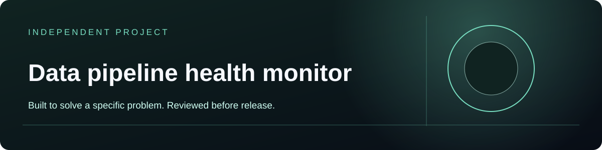

# Data Pipeline Health Monitor



Teams need to spot data quality and pipeline failures before users do.

Manage dataset, check result, incident report with persistent records, typed forms, search and CSV/JSON import.

**Node.js 24+ · SQLite · Browser interface**

## What works now

- Create, search, edit and delete typed records for Dataset, Check Result, Incident Report.
- Import CSV or JSON and export JSON.
- Keep application records in a local SQLite database.
- Run the included CRUD, validation and restart-persistence checks.

## Run locally

From this repository, run:

```sh
node server.mjs
```

Then open http://127.0.0.1:4322. The address works only while this server is running on this computer. To run another local project at the same time, choose a different port; for example, in PowerShell run `$env:PORT=4322; node server.mjs` and open http://127.0.0.1:4322. On macOS/Linux run `PORT=4322 node server.mjs`.

No package installation or build step is required. Records live in `data/app.sqlite`, which is excluded from Git; back up `data/` to preserve them.

## Validate

```sh
node --test app.test.mjs
```

These checks cover the generic data workspace. Review the project's domain-specific behavior and acceptance criteria separately in `QA.md`.

## Scope and hosting

This is a single-owner data workspace. It does not implement external integrations, payments, multi-user roles or domain-specific algorithms beyond the generated collection schema. It has no public website deployment. For access outside this computer, use a private network or a reviewed host with HTTPS, a strong `APP_PASSWORD` and persistent storage; a source repository alone does not run the server.
